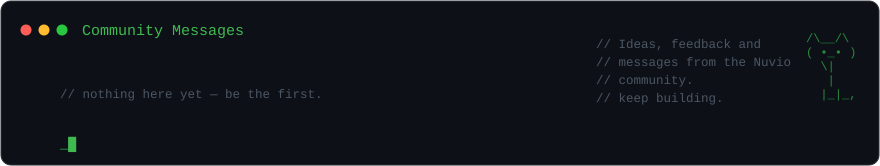

# NUVIO ECOSYSTEM

**A curated collection of independent Nuvio projects.**

Discover plugins · Explore addons · Get direct links

---

[**PROJECTS**](#plugin-library)　·　
[**ADDONS**](#external-addons)　·　
[**ANDROID APP**](#nuvio-android)　·　
[**COMMUNITY**](#community)

---

## ✦ THE HUB

مساحة تجمع مشاريعي وإضافاتي المستقلة لنظام Nuvio، مع روابط JSON مباشرة وواضحة ومصادر المشاريع.

- روابط Manifest ظاهرة بالكامل.
- كل إضافة في قسم مستقل.
- روابط المستودعات الأصلية متاحة.
- روابط تنزيل Nuvio تتجه تلقائياً إلى أحدث إصدار.

---

# 🚀 PLUGIN LIBRARY

01 / NUVIO COMMUNITY PROJECTS

إضافات مستقلة للأفلام والمسلسلات.

<table>
<tr>
<td width="50%" valign="top" align="center">

<h3>CINEMABOX</h3>

<strong>انسخ رابط JSON</strong>

<code>https://raw.githubusercontent.com/hashimxc12/CinemaBox2/main/manifest.json</code>

<strong>Movies &amp; TV Shows</strong>

مصدر أفلام ومسلسلات يدعم العربية والإنجليزية.

<a href="https://github.com/hashimxc12/CinemaBox2">SOURCE CODE ↗</a>

</td>
<td width="50%" valign="top" align="center">

<h3>CINEMANA</h3>

<strong>انسخ رابط JSON</strong>

<code>https://raw.githubusercontent.com/hashimxc12/Cinemana_NuvioPlugin/main/manifest.json</code>

<strong>Movies &amp; TV Shows</strong>

مصدر مستقل للأفلام والمسلسلات من Cinemana.

<a href="https://github.com/hashimxc12/Cinemana_NuvioPlugin">SOURCE CODE ↗</a>

</td>
</tr>
</table>

---

## 🧩 EXTERNAL ADDONS

02 / SUBTITLES · METADATA · DISCOVERY

إضافات متوافقة مع نظام Stremio Addons المدعوم في Nuvio.

<table>
<tr>
<td width="50%" valign="top" align="center">

<h3>OPENSUBTITLES</h3>

<strong>رابط JSON — انسخه مباشرة</strong>

<code>https://opensubtitles-v3.strem.io/manifest.json</code>

<strong>SUBTITLE ADDON</strong>

للبحث عن الترجمات وعرضها أثناء المشاهدة.

<a href="https://www.opensubtitles.com/">SOURCE WEBSITE ↗</a>

</td>
<td width="50%" valign="top" align="center">

<h3>RODRIGO'S CATALOG</h3>

<strong>رابط JSON — انسخه مباشرة</strong>

<code>https://digok.github.io/nuvio-catalog/manifest.json</code>

<strong>IMDb · MOVIE &amp; TV METADATA</strong>

كتالوج لاكتشاف الأفلام والمسلسلات وعرض بياناتها وتقييماتها، ولا يوفر تشغيل الفيديو.

<a href="https://github.com/Digok/nuvio-catalog">SOURCE CODE ↗</a>

</td>
</tr>
</table>

---

## ⚡ ALL-IN-ONE

<h3>ONE HUB. MULTIPLE EXPERIENCES.</h3>

<strong>COMING SOON</strong>

مشروع قيد التطوير لتجميع مجموعة من الوظائف في تجربة واحدة.

---

## 🧭 DEVELOPER RESOURCES

| RESOURCE | DESCRIPTION |
|---|---|
| <a href="https://github.com/NuvioMedia/NuvioMobile">Nuvio Mobile</a> | Official Android application |
| <a href="https://github.com/NuvioCommunity/plugins">Nuvio Plugins</a> | Community plugin directory |
| <a href="https://nuvio.tv">Nuvio Website</a> | Official website |

---

# 📱 NUVIO ANDROID

03 / ALWAYS THE LATEST RELEASE

حمّل أحدث إصدار من تطبيق Nuvio مباشرة من GitHub.

| Architecture | Direct APK |
|---|---|
| **ARM64 · 64-bit** | [DOWNLOAD ↗](https://github.com/NuvioMedia/NuvioMobile/releases/latest/download/androidApp-full-arm64-v8a-release.apk) |
| **ARMv7 · 32-bit** | [DOWNLOAD ↗](https://github.com/NuvioMedia/NuvioMobile/releases/latest/download/androidApp-full-armeabi-v7a-release.apk) |
| **x86 · 32-bit** | [DOWNLOAD ↗](https://github.com/NuvioMedia/NuvioMobile/releases/latest/download/androidApp-full-x86-release.apk) |
| **x86_64 · 64-bit** | [DOWNLOAD ↗](https://github.com/NuvioMedia/NuvioMobile/releases/latest/download/androidApp-full-x86_64-release.apk) |

Latest-release URLs update automatically when matching asset names are published.

---

## 📥 INSTALLATION GUIDE

**English**

1. Choose an addon or plugin.
2. Copy its complete Manifest URL.
3. Open Nuvio.
4. Go to Settings → Content & Discovery → Plugins.
5. Select Add Repository.
6. Paste the URL and continue.

**العربية**

1. اختر الإضافة المطلوبة.
2. انسخ رابط JSON الظاهر تحت شعارها.
3. افتح تطبيق Nuvio.
4. انتقل إلى Settings ثم Content & Discovery ثم Plugins.
5. اختر Add Repository.
6. الصق الرابط وأكمل التثبيت.

---

## 🛠️ PROJECT STRUCTURE

Each Nuvio plugin repository may include:

| FILE | PURPOSE |
|---|---|
| `manifest.json` | Plugin metadata and configuration |
| `index.js` | Plugin implementation |

---

## 👨‍💻 DEVELOPER

### HASHIMXC12

Independent Developer · Nuvio Ecosystem

---

# 📊 DEVELOPER STATISTICS

### PROJECT PERFORMANCE

| PROJECT | REPOSITORY | STARS |
|---|---|---|
| CinemaBox | [Repository ↗](https://github.com/hashimxc12/CinemaBox2) |  |
| Cinemana | [Repository ↗](https://github.com/hashimxc12/Cinemana_NuvioPlugin) |  |

---

# 💬 COMMUNITY

### YOUR IDEAS SHAPE THE ECOSYSTEM

شارك اقتراحاتك، أبلغ عن المشاكل، وناقش تطوير الإضافات.

**COMMUNITY CHANNELS**

[GENERAL](https://github.com/hashimxc12/hashimxc12/discussions/categories/general) · [IDEAS](https://github.com/hashimxc12/hashimxc12/discussions/categories/ideas) · [Q&A](https://github.com/hashimxc12/hashimxc12/discussions/categories/q-a)

[POLLS](https://github.com/hashimxc12/hashimxc12/discussions/categories/polls) · [SHOW & TELL](https://github.com/hashimxc12/hashimxc12/discussions/categories/show-and-tell) · [ANNOUNCEMENTS](https://github.com/hashimxc12/hashimxc12/discussions/categories/announcements)

---

### 🗨️ COMMUNITY MESSAGES

[WRITE A MESSAGE ↗](https://github.com/hashimxc12/hashimxc12/discussions/1)

<!-- GITCOMMENT:START -->

<a href="https://github.com/hashimxc12/hashimxc12/discussions/1">LEAVE A MESSAGE</a>

<!-- GITCOMMENT:END -->

Messages appear here after approval by the repository owner.

---

**BUILT FOR THE NUVIO COMMUNITY**

Independent community projects. Not officially affiliated with Nuvio or its developers.

HASHIMXC12 · 2026

