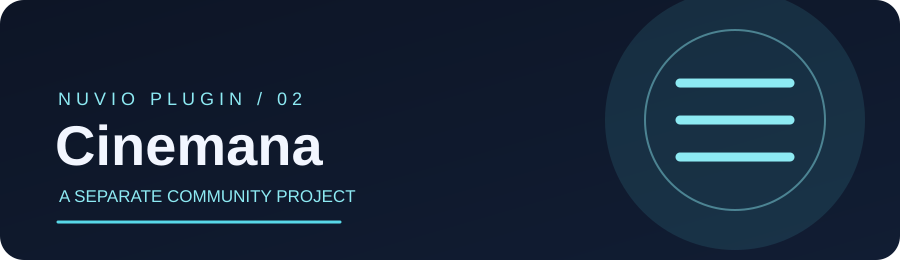
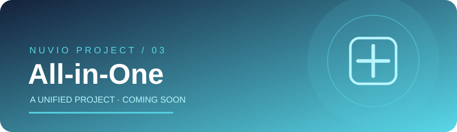

# NUVIO PLUGIN HUB

### Discover • Connect • Install

Independent plugin projects for the Nuvio ecosystem.

EXPLORE THE HUB · CHOOSE A PROJECT · JOIN THE COMMUNITY

---

## ✦ About This Hub

Welcome to my developer hub.

Here you can discover my Nuvio plugin projects, access their source repositories, and copy their manifest URLs.

مرحباً بك في صفحة مشاريعي. هنا تجد إضافات Nuvio وروابط التثبيت والمصادر الرسمية للمطورين.

---

## 🚀 PROJECT SHOWCASE

THREE PROJECTS · ONE DEVELOPER HUB

### 🎬 CINEMABOX

**Independent Nuvio plugin project**

[↗ SOURCE CODE](https://github.com/hashimxc12/CinemaBox2) · [↗ MANIFEST](https://raw.githubusercontent.com/hashimxc12/CinemaBox2/main/manifest.json)

---

### 📺 CINEMANA

**A separate plugin project for Nuvio**

[↗ SOURCE CODE](https://github.com/hashimxc12/Cinemana_NuvioPlugin) · [↗ MANIFEST](https://raw.githubusercontent.com/hashimxc12/Cinemana_NuvioPlugin/main/manifest.json)

---

### ⚡ ALL-IN-ONE

**Unified project concept · Coming soon**

---

## 🧭 Developer Resources

Official Nuvio resources for developers and plugin creators.

| Resource | Description |
|---|---|
| [Nuvio Mobile](https://github.com/NuvioMedia/NuvioMobile) | Official Nuvio application source |
| [Nuvio Plugins](https://github.com/NuvioCommunity/plugins) | Official plugin directory |
| [Nuvio Website](https://nuvio.tv) | Official website |

---

## 📲 How to Install

1. Choose a plugin above.
2. Copy its Manifest URL.
3. Open Nuvio.
4. Navigate to **Settings → Content & Discovery → Plugins**.
5. Select **Add Repository**.
6. Paste the Manifest URL and install.

**طريقة التثبيت بالعربي**

1. اختر الإضافة المطلوبة.
2. انسخ رابط Manifest.
3. افتح تطبيق Nuvio.
4. ادخل إلى الإعدادات ثم Content & Discovery ثم Plugins.
5. اختر Add Repository.
6. الصق الرابط وأكمل التثبيت.

---

## 🛠️ Plugin Structure

Each project repository includes:

- `manifest.json` — Plugin metadata and configuration.
- `index.js` — Plugin implementation.

---

## 👨‍💻 Developer

### HASHIMXC12

**Independent Developer**

---

## 💬 COMMUNITY SPACE

**Your feedback helps these projects grow.**

[✍️ JOIN THE DISCUSSION](https://github.com/hashimxc12/hashimxc12/discussions/1)

<!-- GITCOMMENT:START -->
<!-- GITCOMMENT:END -->

Comments appear here after approval.

---

Built with passion for the Nuvio community.

Independent community projects. Not officially affiliated with Nuvio or its developers.

